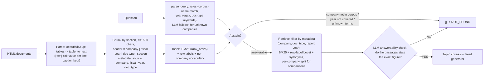

# FTEC5660 Homework 4: the retrieval half of a RAG assistant

## Homework 4 solution

### Pipeline

**Description.** Parsing uses BeautifulSoup; every `<table>` is linearised by
`table_to_text` into one line per row (`Revenue | 2025: 2,710.4 | 2024:
2,629.1`), so a value never loses its row label, column header or the caption
with the unit. Chunking follows the document structure (sections, paragraphs,
lists, table blocks) with a hard 1,500-character cap, and every chunk starts
with a short contextual header (company, fiscal year, doc type, section) that
makes the chunk self-describing to both BM25 and the generator. The index is a
single BM25 (rank_bm25) over all chunks, plus precomputed table row labels and
a per-company vocabulary. Retrieval is routing-first: `parse_query` extracts
companies, fiscal year and doc type with deterministic rules (an LLM is only a
fallback for company names that are not in the corpus); candidate chunks are
filtered by metadata — the right company, the right doc type, and for annual
reports the report of the asked year or, for prior-year figures, the year
after (the prior-year column) — and only then ranked by BM25 with a boost for
chunks whose table row labels match the question's content words, plus a small
synonym expansion. Comparison questions retrieve per company and interleave,
so both sides are always represented. Abstention has four deterministic
layers (unknown company, uncovered year, missing doc type, distinctive
question terms absent from the company's documents) and one LLM layer that
asks whether the retrieved passages actually state the exact figure asked —
this catches undisclosed items such as "lobbying expenses" that pass every
structural check.

### Ablation study (public_test, 60 questions; `ablation.py`)

| Config | One change vs the row above | recall@5 | kept | rejected | answer accuracy |
| --- | --- | --- | --- | --- | --- |
| B0 | naive RAG (Tutorial 7: `get_text()`, `RecursiveCharacterTextSplitter`, BM25 top-5, no parsing, never abstains) | 26.1% | 100% | 0.0% | 43.3% |
| V1 | + `table_to_text` for the tables | 23.9% | 100% | 0.0% | 41.7% |
| V2 | + section-aware chunking with contextual chunk headers | 73.9% | 100% | 0.0% | 78.3% |
| V3 | + `parse_query` routing: company/doc-type/year filtering, per-company retrieval for comparisons | 91.3% | 100% | 71.4% | 93.3% |
| V4 | + table row-label boost and query expansion | 100.0% | 100% | 71.4% | 100.0% |
| V5 | + abstention (rules + LLM answerability check) — the submitted pipeline | 100.0% | 100% | 100.0% | 100.0% |

**Why each change helped (or did not).**
B0 fails exactly as the handout predicts: BM25 cannot tell Northgate Robotics
from Northgate Payments or 2024 from 2025, tables are shredded by naive
`get_text()`, and five chunks of one company cannot answer a comparison.
**V1** is the negative control: `table_to_text` alone slightly *hurts* a naive
pipeline (26.1% → 23.9% recall), because the character splitter cuts the long
table lines at arbitrary points and mixes them with narrative text — the
structure survives neither the splitter nor the ranking. It pays off only once
chunking respects it. **V2** is the biggest single jump (+50 points of
recall): section-aware chunks keep each table whole and each fact next to its
section, and the contextual header puts the company name, year and doc type
inside every chunk, which alone fixes most wrong-company and wrong-year
matches. **V3** (+17.4 recall) routes by metadata instead of hoping lexical
similarity gets it right; per-company retrieval makes every comparison
answerable in principle, and the year filter sends FY2023 questions to the
FY2024 report (prior-year column). As a side effect, the filters already
reject 71.4% of the unanswerable questions (unknown company or uncovered year
simply have no candidates). **V4** fixes the residual misses: narrative MD&A
paragraphs out-ranked the financial-statement tables they summarise, so a
boost for chunks whose table row labels match the question's content words
("gross profit", "inventories") plus small synonym expansions ("cash" →
"equivalents") brought recall to 100%. **V5** changes nothing for answerable
questions (kept stays 100%) but rejects the last four unanswerable ones —
undisclosed figures such as lobbying expenses — via the LLM answerability
check, taking rejected to 100%.

### Error analysis

The intermediate variants expose the failure modes, in the order the pipeline
fixes them. (1) **Entity and year confusion** (dominant in B0–V2): chunks of
the wrong company (Brightwater Software vs Brightwater Energy) or the wrong
column year, because every report mentions two years and names share words —
fixed by metadata filtering and per-company retrieval. (2) **Shredded tables**
(B0–V1): naive text extraction loses the row/column structure, so the right
document is retrieved but the figure is unreadable — fixed by
`table_to_text` plus structure-aware chunking. (3) **Narrative out-ranking
tables** (V3): MD&A text repeats the question's words more often than the
one-line table row that holds the exact figure — fixed by the row-label
boost. (4) **Undisclosed figures** (V4): questions that are structurally
answerable (company and year exist) but ask for something the company does
not publish; the fixed generator already answered NOT_FOUND for these, but
only the LLM answerability check makes the retrieval itself abstain. The
remaining risk on the private set sits in layer 5: a false "not answerable"
verdict from the LLM check would cost one answerable question, so the check
fails open (keeps the chunks) on any error, and the deterministic layers
below it carry most of the abstention load (10 of 14 public cases).

### Results on public_test (`python3 hw4.py --data-folder public_test`)

Task 1.1 100.0% · Task 1.2 100.0% · Task 2.1 100.0% · Task 2.2 100.0% ·
recall@5 100.0% · kept 100.0% / rejected 100.0% · answer accuracy 100.0%
(estimated 75.0/75; about 52 LLM calls of my own, mostly the answerability
check, and ~50 s end-to-end).

## Homework 4 reflection (Task 6)

Ten years from now, when a personal agent can write, code, research and even
run a business for anyone, I keep coming back to a simple thought: this
homework is a small preview of that world. The generator was fixed; the only
thing that mattered was the judgment of what to show it. In a world of
abundant machine capability, what remains scarce is exactly that — judgment,
and the willingness to stand behind it.

**Who I want to be.** Someone who decides what is worth doing and takes
responsibility for the answer, not someone who merely operates ever-stronger
tools. An agent can retrieve five chunks; choosing what counts as evidence,
when to distrust a confident answer, and when to say "this cannot be answered
from what we have" is a human stance. I want to be the person in the room who
asks "how do we know this?" when everyone else is admiring the fluency.

**Ambitions that still matter.** The ones that were never about output.
Understanding a domain deeply enough to notice when something is off still
matters — arguably more, because errors now arrive at scale and with perfect
grammar. Ambitions tied to speed and volume will quietly stop mattering, and
I think that is fine.

**Beyond productivity.** I would want to be known for being trustworthy under
uncertainty: the colleague who says "I don't know" when that is the truth,
the friend who shows up in person, someone whose taste and principles stayed
legible when delegating became effortless. Nobody is remembered for their
prompts.

**What I am willing to struggle for.** Learning things the slow way even when
an agent could hand me the result — reading the primary source, deriving the
number myself first, writing the first draft badly. Not because the struggle
is efficient, but because it is where judgment is built, and judgment is the
one input the system cannot synthesise for me. Relationships, too: they are
supposed to cost time.

**What still makes me valuable.** Verification habits, domain knowledge,
accountability, and the ability to work with people — negotiating, mentoring,
disagreeing well. An agent can produce fifty answers; being the person who
can say which one to sign is a skill, not a personality trait, and I intend
to keep training it.

**If value is not what I can do.** Then identity has to come from what I
choose to care about and what I refuse to outsource: my responsibilities, my
curiosity, my word. I am not my output; I am the set of things I would still
do if no one could measure them.

**Starting tomorrow.** Two small changes. First, verify before I delegate:
form my own rough answer before asking an agent, so I can tell when it is
wrong — the same discipline this homework's reflection layer encodes in
software. Second, protect a few hours a week for unassisted work and for
people, not because it optimises anything, but because that is the part of
life I do not want augmented away.

*(Reflection written with AI assistance, as permitted by the assignment.)*
